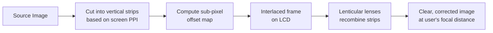

<div align="center">

# 👁️ CamLens

### Privacy-First Optical Vision Correction Engine

*Read, code, and work clearly — without prescription glasses and without a camera watching you.*


**Team:** Apex_Coders &nbsp;|&nbsp; **Competition:** Huawei ICT Innovation Track 2026

</div>

---

## 📌 Project Overview

CamLens is a software-based vision correction system. It replaces expensive, privacy-invasive hardware eye-tracking cameras with a **1D lenticular sheet** and a real-time **NumPy vectorized interlacing engine**.

By dynamically restructuring on-screen pixels, CamLens compensates for refractive errors (like myopia), allowing users to read text, write code, and view dashboards clearly — **without wearing prescription glasses** and **without camera surveillance**.

---

## 🚀 Core Features

| | Feature | Description |
|---|---|---|
| 🔒 | **Privacy-First Design** | Zero cameras used. The system relies entirely on computational optics and manual digital calibration. |
| ⚡ | **Real-Time Vectorization** | Built with pure `NumPy` array manipulations and `OpenCV` affine transformations, ensuring **zero latency** and minimal CPU overhead. |
| 🎯 | **Hardware Calibration Mode (F11)** | A pixel-perfect fullscreen mode that aligns the software's interlacing pitch with the physical 1D lenticular sheet down to the micrometer. |
| 👀 | **Digital Eye-Shift (A / D keys)** | A software alternative to eye-tracking. Users dynamically shift the optical "sweet spot" to match their viewing angle using simple keyboard inputs. |
| 🖥️ | **Interactive UI** | Built with `customtkinter`, featuring dynamic in-memory sample generators for text documents, code editors, and UI dashboards. |

---

## 🔬 The Physics Behind CamLens

When a 1D lenticular sheet is placed over a standard LCD display, it acts as an array of magnifying cylindrical lenses.

Our `interlacer.py` engine cuts the source image into microscopic vertical strips corresponding to the screen's actual PPI (Pixels Per Inch). It then calculates a precise sub-pixel offset map to distribute these strips under the lenticular lenses at specific angles. When the user looks at the screen, the lenses recombine the scrambled strips into a unified, clear, and optically corrected image targeting the user's focal distance.



---

## 🛠️ System Architecture

| Layer | Technology |
|---|---|
| **Frontend** | `customtkinter` (dark-mode responsive UI) |
| **Image Processing Engine** | `OpenCV` (cv2) |
| **Algorithm Acceleration** | `NumPy` (vectorized array math) |
| **Optical Hardware** | 1D lenticular plastic sheet |

---

## ⚙️ Quick Start

### 1. Clone the repository

```bash
git clone https://github.com/Mohamed-Magdy-one/CamLens-Huawei-Innovation.git
cd CamLens-Huawei-Innovation
```

### 2. Install dependencies

```bash
pip install numpy opencv-python customtkinter
```

### 3. Run the application

```bash
python main.py
```

---

## ⌨️ Controls & Calibration Guide

Once the application is running, use the built-in UI tests (**Text**, **Code**, **UI**). For physical lenticular calibration, use the following keyboard shortcuts:

| Action | Shortcut Key | Description |
|---|:---:|---|
| **Enter Calibration** | `F11` | Hides all UI elements and displays a pixel-perfect calibration pattern. |
| **Adjust Lens Pitch** | `←` / `→` | Macro adjustment of the physical lens width (0.1px steps). |
| **Micro Pitch Adjust** | `↑` / `↓` | Micro adjustment for removing Moiré patterns (0.01px steps). |
| **Digital Eye Shift** | `A` / `D` | Shifts the sub-pixel array left/right to change the viewing angle. |
| **Exit Calibration** | `Esc` | Returns to the main UI and saves calibration metrics. |

### Calibration workflow

1. Place the lenticular sheet on your display and press **`F11`** to enter calibration mode.
2. Use **`←` / `→`** to roughly match the software pitch to the physical lens width.
3. Use **`↑` / `↓`** to fine-tune until the Moiré pattern disappears.
4. Use **`A` / `D`** to shift the sweet spot until the image looks sharp from your seating position.
5. Press **`Esc`** to save your calibration and return to the main UI.

---

<div align="center">

*Built with ❤️ by Team Apex_Coders for the Huawei ICT Innovation Competition.*

</div>
